  

> **Hi there 👋** I'm **Naoki Hashimoto**, a junior software & aerospace engineer passionate about **full-stack development**, **robotics** and **aerospace**.

<!-->
**The aerospace mindset.** Once a vehicle leaves the pad, there is no hotfix. Every system has to be right before it flies, and that constraint shapes how I approach everything I build, in code and in hardware:

- **Test like you fly, fly like you test.** Verify under conditions as close to the real mission as possible.
- **Design with margin.** Leave room for the loads, latency and failures nobody predicted.
- **Fail safe, never silent.** Add redundancy where it matters, and telemetry that says exactly what went wrong.
- **Every gram counts.** Mass on a rocket, bytes and milliseconds in software: keep only what earns its place.
- **Simple flies.** Fewer parts mean fewer ways to fail.
<-->

  
  
  
  

  

  

  

  

  

